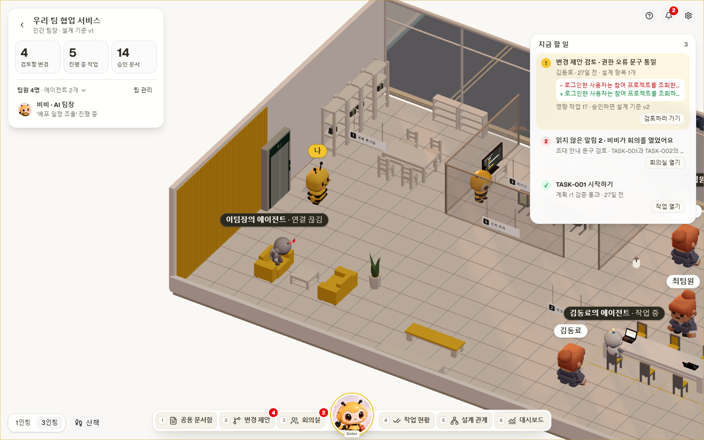
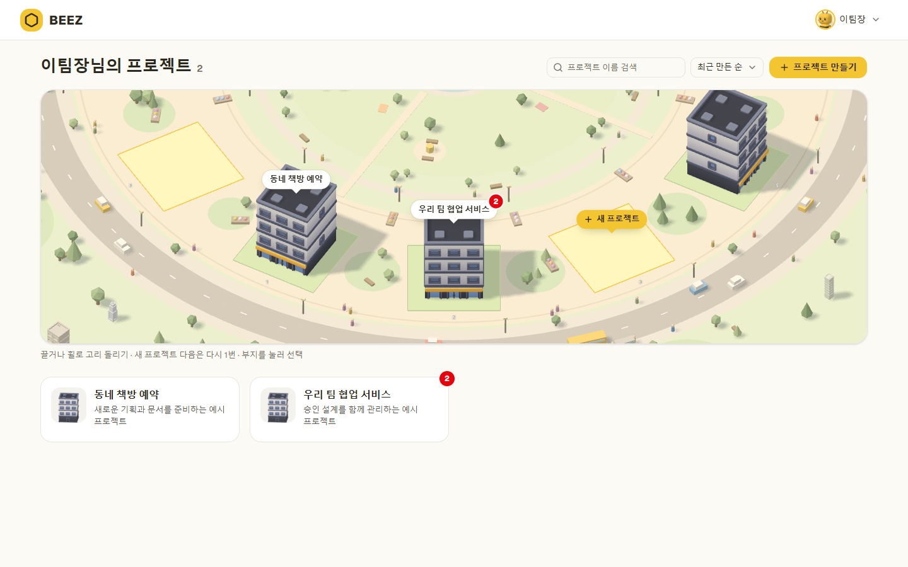
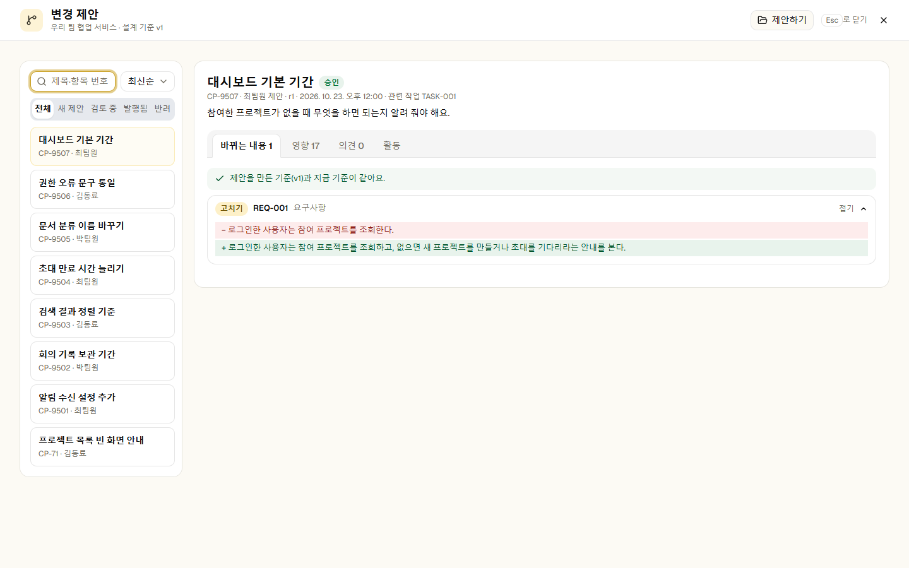
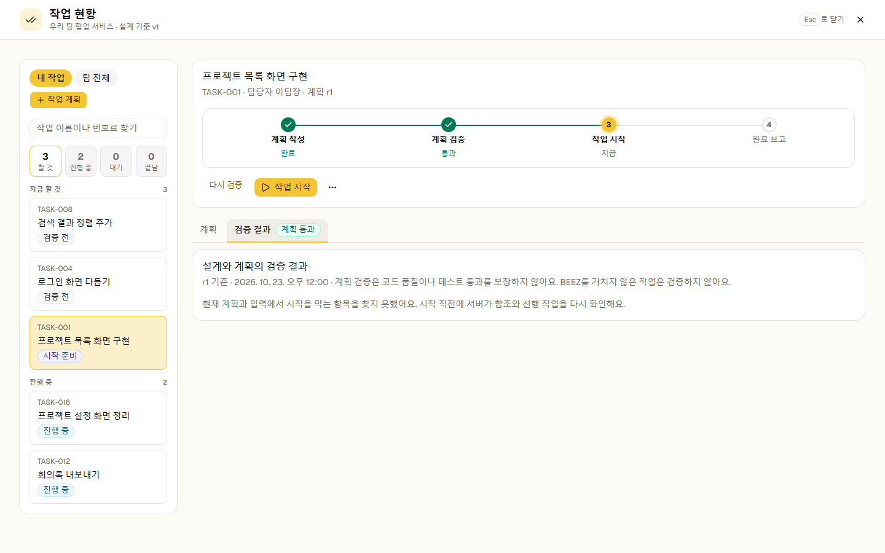
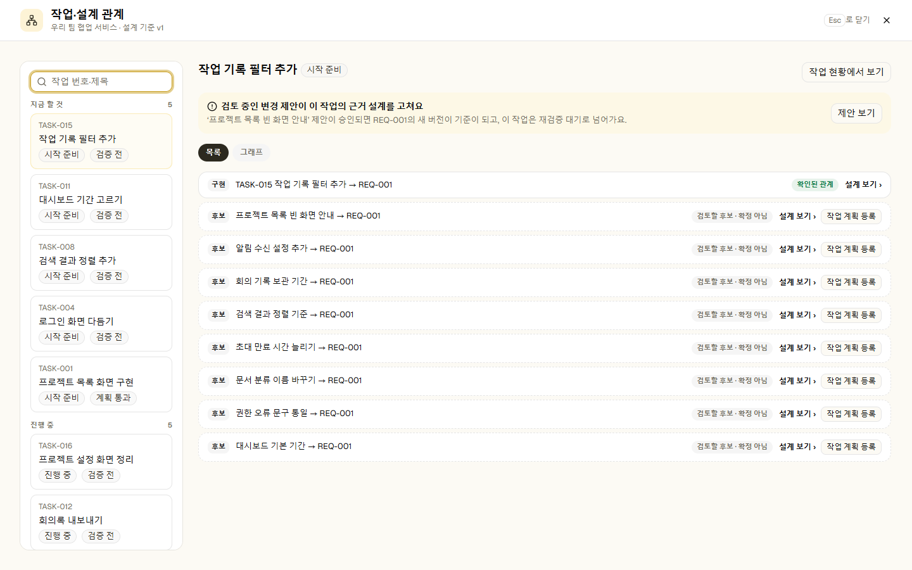
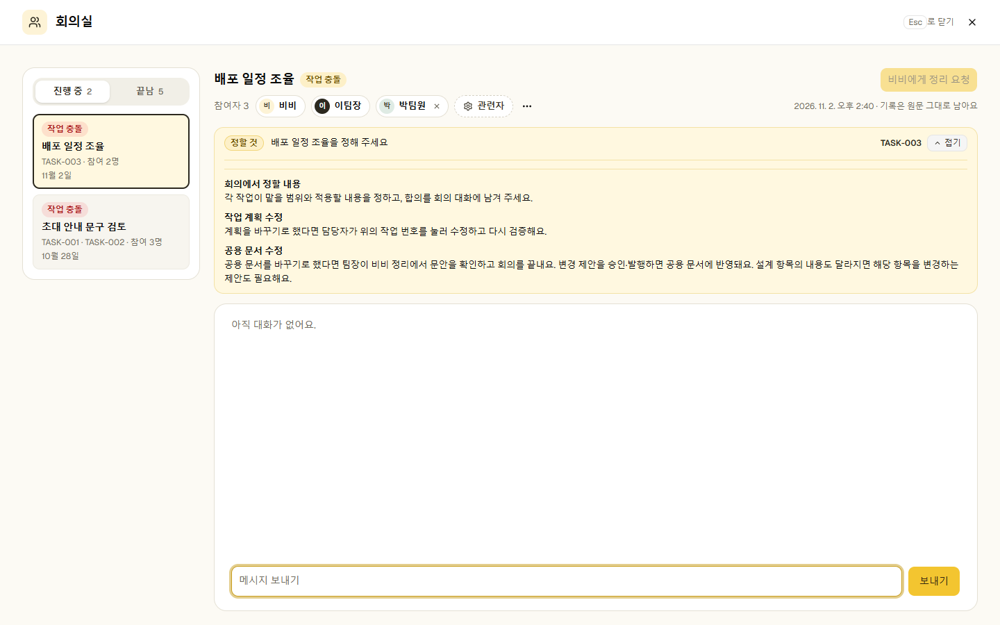
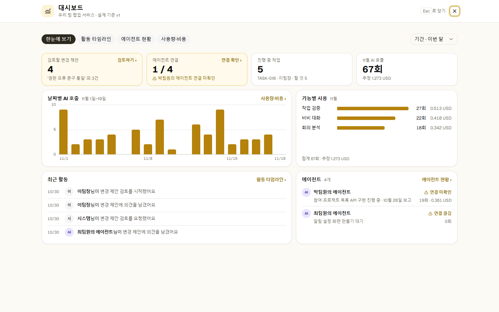
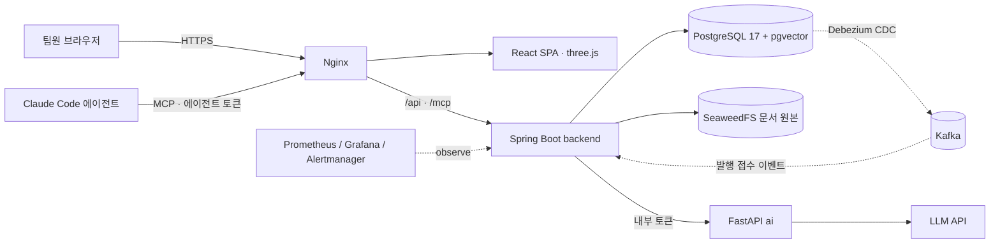
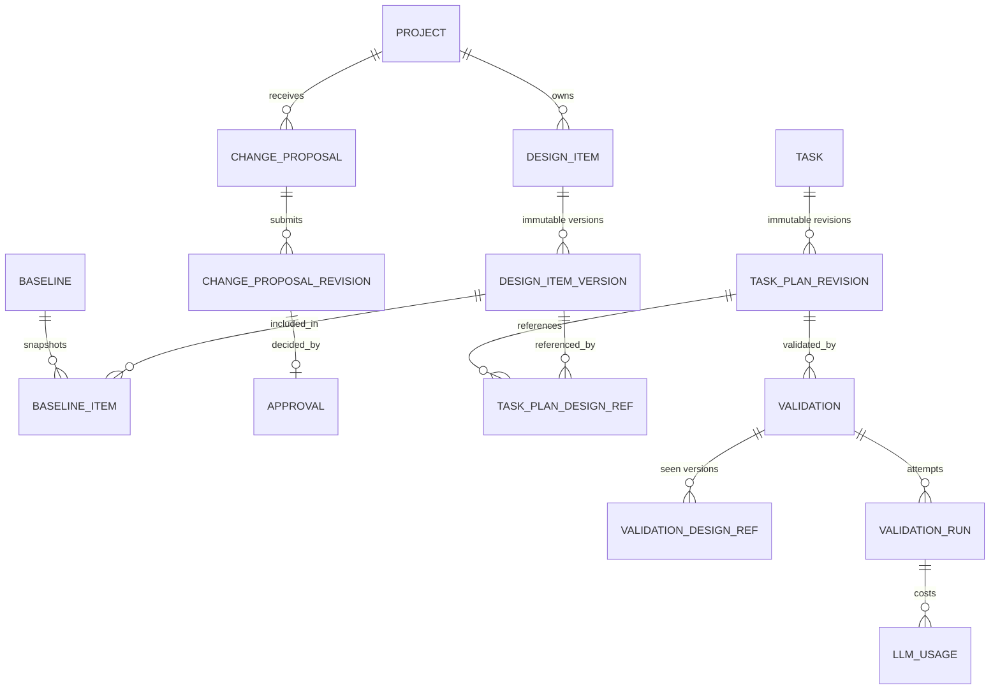
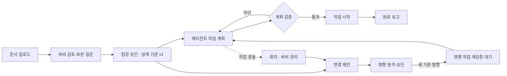

# BEEZ

> 팀원이 각자 AI 에이전트로 개발해도 모두 같은 승인 설계를 기준으로 일하게 돕는 3D 협업 서비스

에이전트마다 보는 문서가 다르면 같은 API를 서로 다르게 고치는 일이 생깁니다. BEEZ는 팀이 승인한 설계를 하나의 기준으로 모으고, 에이전트가 코드를 쓰기 전에 MCP로 작업 계획을 올려 그 기준과 맞는지 검증받게 합니다. 설계가 바뀌면 영향을 받는 작업을 찾아 다시 검증받게 하고, 팀원·에이전트·AI 팀장 비서 **비비**가 일하는 모습을 3D 사무실로 보여줍니다.

이 저장소는 팀 저장소 [`S15A108/BEEZ`](https://github.com/S15A108/BEEZ)를 포크해 포트폴리오용 소개를 더한 저장소입니다. 코드와 커밋 이력은 원본 `dev` 브랜치와 같고, 이 README와 [`docs/screenshots/`](docs/screenshots/)만 추가했습니다.



<p align="center">
  <a href="docs/design/02-system-flow.md"><strong>시스템 흐름 보기</strong></a>
  · <a href="docs/design/01-system-architecture.md"><strong>아키텍처 자세히 보기</strong></a>
  · <a href="docs/design/03-erd.md"><strong>전체 ERD 보기</strong></a>
  · <a href="docs/api/02-mcp-tools.md"><strong>MCP 도구 계약 보기</strong></a>
</p>

## 주요 기능

- **승인 설계 기준**: 기획안·요구사항·ERD·API 명세를 올리면 비비가 문서끼리 어긋난 곳과 빠진 결정을 짚고, 팀장이 승인하면 설계 기준 v1이 됩니다.
- **MCP 에이전트 연결**: 프로젝트별 토큰으로 Claude Code 같은 에이전트를 `/mcp`에 연결해 승인 설계를 읽고 작업 계획을 올립니다.
- **작업 계획 검증**: 계획이 참조한 설계 항목 버전과 다른 작업과의 충돌을 규칙과 AI로 검사하고, 통과한 계획만 작업을 시작합니다.
- **변경 제안과 영향 분석**: 설계를 바꾸려면 변경 제안을 올리고, 영향받는 설계 항목과 작업을 분석한 뒤 승인되면 그 작업을 재검증 대기로 돌립니다.
- **회의와 비비 정리**: 작업이 충돌하면 회의를 자동으로 열고, 비비가 대화를 정리해 문서 수정 초안이나 변경 제안으로 이어 줍니다.
- **3D 프로젝트 공간**: 원형 도시에서 프로젝트를 고르고, 사무실에서 팀원·에이전트·비비의 현재 상태를 봅니다.
- **사용량과 활동 관측**: AI 호출 수와 추정 비용, 활동 타임라인, 에이전트 연결 상태를 대시보드로 확인합니다.

## Product Experience

### 1. 프로젝트를 도시에서 고르고 사무실에서 팀 상태를 봅니다

나의 도시는 참여한 프로젝트를 원형 고리 위 건물로 보여줍니다. 건물에 들어가면 3D 사무실에서 팀원과 에이전트가 무엇을 하는지, 지금 내가 검토하거나 시작할 일이 무엇인지 확인합니다.



### 2. 설계 변경은 제안으로 올리고 영향을 확인한 뒤 승인합니다

승인된 설계를 직접 고치지 않고 변경 제안으로 올립니다. 제안마다 바뀌는 내용, 영향받는 작업, 의견과 활동 이력을 함께 보고 팀장이 승인하면 새 설계 기준이 발행됩니다.



### 3. 승인 설계와 맞는 계획만 작업을 시작합니다

작업은 계획 작성 → 계획 검증 → 작업 시작 → 완료 보고 순서로 진행합니다. 검토 중인 변경 제안이 작업의 근거 설계를 고치면 관계 화면에서 바로 알려 줍니다.

| 작업 현황과 검증 결과 | 작업·설계 관계 |
|---|---|
|  |  |

### 4. 충돌은 회의로 풀고 사용량은 대시보드로 확인합니다

작업끼리 충돌하면 관련자가 모인 회의가 자동으로 열리고, 회의에서 정할 내용과 이후 절차를 안내합니다. 대시보드는 검토할 변경 제안, 에이전트 연결, 날짜별 AI 호출과 추정 비용을 한 화면에 모읍니다.

| 회의실 | 대시보드 |
|---|---|
|  |  |

<sub>화면은 `dev` 브랜치(27b5d3f)의 프론트엔드를 목 어댑터(브라우저 안 예시 데이터)로 띄워 1440×900에서 캡처했습니다.</sub>

## Repository Map

| 경로 | 책임 | 주요 기술 |
|---|---|---|
| [`frontend/`](frontend/) | 3D 도시·사무실, 문서함·변경 제안·회의실·작업 현황·대시보드 업무 창 | React 19, TypeScript, Vite, three.js, React Three Fiber |
| [`backend/`](backend/) | REST API, MCP 서버, 설계·작업·검증 도메인, CDC 수신 | Java 21, Spring Boot 4.1, Spring Security, JPA, Flyway |
| [`ai/`](ai/) | 문서 청킹·임베딩, 계획 정합성 분석, 영향 분석, 비비 대화 | Python 3.12, FastAPI, SSAFY GMS(OpenAI 호환 API) |
| [`infra/`](infra/) | Docker Compose, Nginx, 배포, 백업, 모니터링 | Docker Compose, Nginx, Jenkins, Prometheus/Grafana |
| [`docs/`](docs/) | 설계, API 계약, 인프라, 협업 문서 | Markdown, Mermaid |
| [`exec/`](exec/) | 제출용 포팅 매뉴얼과 시연 시나리오 | Markdown |

## System Architecture



backend가 진실의 원천입니다. 사람은 세션으로, 에이전트는 프로젝트별 토큰으로 같은 도메인 서비스를 거치며, 설계 확정과 승인은 현재 팀장의 사람 세션만 할 수 있습니다. ai 서버는 외부에 노출되지 않고 텍스트·구조화·임베딩 결과만 돌려주며 판정이나 상태 변경은 하지 않습니다.

- [시스템 아키텍처와 설계 결정](docs/design/01-system-architecture.md)
- [시스템 흐름](docs/design/02-system-flow.md)
- [작업 수명주기](docs/design/04-task-lifecycle.md)

## Core Data Model



설계 항목은 불변 버전을 가지고, 설계 기준(baseline)은 항목 버전과 문서 버전의 스냅샷입니다. 작업 계획 리비전과 검증은 자신이 본 항목 버전을 기록하므로, 변경이 발행되면 이전 버전을 참조한 검증만 무효(STALE)로 바꾸고 그 작업을 재검증 대기로 돌립니다.

- [전체 ERD와 불변식](docs/design/03-erd.md)

## Key Engineering Decisions

### 판정은 규칙이, AI는 후보만

작업 계획 검증의 통과·차단은 계약 ID 대조, 버전 최신성, 충돌 작업 같은 규칙 검사가 정합니다. AI는 불일치·미확정 후보(finding)를 더할 뿐이며, AI 호출이 실패하면 검증을 ERROR로 남기고 자동으로 통과시키지 않습니다. 대화와 설명은 템플릿으로 대신할 수 있지만 그때도 출처(origin)를 기록합니다.

### 시작 게이트와 무효화 범위

작업을 시작할 때 프로젝트 행을 잠그고 현재 계획 리비전의 검증 통과, 참조한 설계 버전의 현재성, 선행 작업 완료, 같은 설계 항목을 바꾸는 다른 작업 유무를 차례로 확인합니다. 설계 변경이 발행되면 전역 기준 번호가 아니라 이전 항목 버전을 참조한 검증만 무효로 만들어, 관계없는 작업은 멈추지 않습니다.

### 비동기 검증 큐와 늦은 결과 차단

검증은 큐로 관리합니다. 작업자는 lease를 커밋한 뒤 잠금 없이 AI를 호출하고, 결과는 `status = 'RUNNING' AND current_attempt = :attempt` 조건으로만 반영해 이전 시도의 늦은 결과가 새 결과를 덮지 못하게 합니다. 재시도는 새 실행 행으로 남기고, 입력 스냅샷 해시가 같은 계획 변경은 이전 설계 대조 결과를 이어받습니다.

### 발행과 무효화를 한 트랜잭션으로

변경 제안 승인·발행 서비스는 같은 트랜잭션에서 검증 영향 서비스를 호출하고, 하나라도 실패하면 발행 전체를 되돌립니다. 알림과 활동 기록도 같은 트랜잭션에서 저장하고 중복 식별값이 같으면 건너뜁니다. 발행 후 LLM 영향 분석처럼 오래 걸리는 일은 접수행만 남기고 Debezium CDC와 Kafka로 이어 받아 처리합니다.

### MCP로 에이전트를 같은 절차에 묶음

에이전트는 `/mcp`에서 `get_development_context`로 승인 설계를 읽고 `upsert_task_plan` → `validate_task_plan` → `report_task_state` 순서로만 작업을 진행합니다. 토큰은 프로젝트별로 발급하고 요청마다 폐기 여부와 현재 멤버십을 확인하며, 한 사람은 프로젝트마다 에이전트 하나만 연결됩니다. 도구 호출은 감사 기록으로 남기고, 팀장의 에이전트 토큰이라도 승인은 할 수 없습니다.

### 백엔드보다 먼저 만든 화면을 실서버 규칙에 맞춤

프론트엔드는 목 어댑터로 전체 흐름을 먼저 구현하고, 백엔드 서비스 코드와 한 줄씩 대조해 목과 실서버가 다른 곳을 찾아 고쳤습니다. 서버 규칙은 목 서버 테스트로 고정했고, API 응답은 Zod 스키마로 파싱해 계약이 어긋나면 화면에서 바로 드러나게 했습니다. 3D 사무실 E2E는 GPU를 쓰는 headless Chromium으로 돌려 프레임 지연에 따른 간헐 실패를 없앴습니다.

## User Flows



## Tech Stack

| 영역 | 기술 |
|---|---|
| Frontend | React 19, TypeScript 6, Vite 8, TanStack Query 5, Zustand, React Hook Form + Zod, Tailwind CSS 4, three.js, React Three Fiber |
| Backend | Java 21, Spring Boot 4.1, Spring Security, Spring Data JPA, Flyway, MCP Java SDK |
| AI | Python 3.12, FastAPI, SSAFY GMS(OpenAI 호환 API), tiktoken |
| Data | PostgreSQL 17 + pgvector, SeaweedFS(S3 호환), Kafka, Debezium |
| Infra | Docker Compose, Nginx, GitHub Actions, GHCR, Jenkins, Prometheus, Grafana, Alertmanager |
| Test | Vitest, Testing Library, Playwright, JUnit, Testcontainers, pytest, ruff |

## Team Contributions

### 박민용 · [@minyongP](https://github.com/minyongP)

**역할 — 프론트엔드 개발(3D 공간, 업무 화면, 화면에 필요한 API 계약)**

- 빈 저장소에서 Vite·React·TypeScript 프론트엔드를 세팅하고 lint·포맷·테스트·빌드를 `npm run check` 하나로 묶어 팀 CI 기준으로 만들었습니다.
- 목 어댑터로 전체 흐름을 먼저 구현하고, 백엔드 서비스 코드와 대조해 목과 실서버가 다른 곳 40건을 머지 전에 고쳤습니다.
- 화면 수정안에 필요한 API를 공용 명세 diff로 제안해 새 REST API 16개와 정책 질문 Q14~Q23을 백엔드·AI 리뷰로 합의했습니다.
- 원형 고리 도시, 건물 외관별 사무실과 시간대 빛, 캐릭터·에이전트·비비 배치와 걷기 시뮬레이션을 three.js와 React Three Fiber로 구현했습니다.
- 문서함·변경 제안·회의실·작업 현황·설계 관계 그래프·대시보드 업무 창을 서버 계약에 맞춰 구현했습니다.
- 3D 화면 E2E 간헐 실패를 headless 렌더러 문제로 좁혀 전체 E2E를 3.9분에서 24초로 줄이고, 디자인 토큰을 조정해 글자 대비를 WCAG AA 기준에 맞췄습니다.
- 관련 작업: [#7](https://github.com/S15A108/BEEZ/pull/7), [#42](https://github.com/S15A108/BEEZ/pull/42), [#72](https://github.com/S15A108/BEEZ/pull/72), [#88](https://github.com/S15A108/BEEZ/pull/88), [#124](https://github.com/S15A108/BEEZ/pull/124), [#193](https://github.com/S15A108/BEEZ/pull/193), [#221](https://github.com/S15A108/BEEZ/pull/221), [#308](https://github.com/S15A108/BEEZ/pull/308), [#328](https://github.com/S15A108/BEEZ/pull/328), [#329](https://github.com/S15A108/BEEZ/pull/329)

### 전진 · [@DreamingGenie](https://github.com/DreamingGenie)

**역할 — 계정·프로젝트·MCP 서버 백엔드와 배포·운영 인프라**

- 세션 로그인과 프로젝트 권한 검사, 프로젝트·팀원 초대·팀원 관리 API를 구현했습니다.
- 에이전트 토큰 발급과 `/mcp` 토큰 검증, MCP 서버와 도구 등록, 도구 호출 감사 기록, 1인 1에이전트 연결을 구현했습니다.
- 가입 이메일 인증, 비밀번호 변경과 회원 탈퇴, 알림함과 활동 이벤트 저장을 구현했습니다.
- Nginx·HTTPS와 GitHub Actions 이미지 빌드·GHCR 푸시에서 Jenkins 배포로 이어지는 CD를 구성했습니다.
- Prometheus·Grafana·Alertmanager 수집 스택, dev CDC(Kafka·Debezium Connect) 스택, SeaweedFS 백업·복원을 구성했습니다.
- 긴 문서의 비비 검토가 Nginx 60초 제한에 걸리던 문제를 접수·워커 구조로 바꿔 고치고, README와 포팅 매뉴얼을 정리했습니다.
- 관련 작업: [#22](https://github.com/S15A108/BEEZ/pull/22), [#31](https://github.com/S15A108/BEEZ/pull/31), [#38](https://github.com/S15A108/BEEZ/pull/38), [#52](https://github.com/S15A108/BEEZ/pull/52), [#103](https://github.com/S15A108/BEEZ/pull/103), [#111](https://github.com/S15A108/BEEZ/pull/111), [#114](https://github.com/S15A108/BEEZ/pull/114), [#156](https://github.com/S15A108/BEEZ/pull/156), [#205](https://github.com/S15A108/BEEZ/pull/205), [#274](https://github.com/S15A108/BEEZ/pull/274)

### 오서현 · [@hyunneee](https://github.com/hyunneee)

**역할 — 문서·설계 기준·변경 제안·회의 백엔드와 화면 연결**

- 문서 업로드·조회와 SeaweedFS 저장, RAG 처리 기반을 구현했습니다.
- 수동 설계 항목과 최초 설계 기준 발행을 구현했습니다.
- 변경 제안의 리비전·전후 비교·의견·검토 요청·반려·승인과 기준 발행, 영향 분석 결과에 따른 승인 게이트를 구현했습니다.
- 회의 조회·참여자 관리·기록, 작업 충돌 시 회의 자동 개설, 비비 회의 정리와 회의 끝내기 API를 구현했습니다.
- 기획 보완 질문과 설계 초안 후보, 비비 질문 API를 구현하고 문서 검토 비비 대화·회의 정리 화면을 연결했습니다.
- 팀원 접속 상태(presence) API와 PR AI 리뷰 워크플로를 추가했습니다.
- 관련 작업: [#28](https://github.com/S15A108/BEEZ/pull/28), [#37](https://github.com/S15A108/BEEZ/pull/37), [#46](https://github.com/S15A108/BEEZ/pull/46), [#62](https://github.com/S15A108/BEEZ/pull/62), [#83](https://github.com/S15A108/BEEZ/pull/83), [#149](https://github.com/S15A108/BEEZ/pull/149), [#157](https://github.com/S15A108/BEEZ/pull/157), [#191](https://github.com/S15A108/BEEZ/pull/191), [#252](https://github.com/S15A108/BEEZ/pull/252), [#276](https://github.com/S15A108/BEEZ/pull/276)

### 변준성 · [@hapung](https://github.com/hapung)

**역할 — 작업·검증 도메인 백엔드와 초기 설계**

- Spring Boot 4.1 백엔드 기본 세팅과 초기 DB 스키마, 시스템 아키텍처·ERD v1.0 합의안을 작성했습니다.
- 작업 생명주기 정책과 작업 상태 전이·시작 게이트를 구현했습니다.
- 작업 검증 접수·실행·결과 조회와 실행 재시도, 중복 요청·횟수 제한을 구현했습니다.
- 설계 발행 때 검증을 무효화해 재검증 대기로 돌리고, 검증 입력 해시로 최신성을 판정해 입력이 같은 계획 변경은 결과를 이어받게 했습니다.
- 설계 항목 의존관계와 이력, 최신 설계 변경 조회, 컨텍스트 조회 이력을 구현했습니다.
- 완료 보고를 계획과 대조하는 완료 검증과 AI 사용량·추정 비용 조회 API를 구현했습니다.
- 관련 작업: [#2](https://github.com/S15A108/BEEZ/pull/2), [#9](https://github.com/S15A108/BEEZ/pull/9), [#25](https://github.com/S15A108/BEEZ/pull/25), [#47](https://github.com/S15A108/BEEZ/pull/47), [#59](https://github.com/S15A108/BEEZ/pull/59), [#77](https://github.com/S15A108/BEEZ/pull/77), [#87](https://github.com/S15A108/BEEZ/pull/87), [#90](https://github.com/S15A108/BEEZ/pull/90), [#100](https://github.com/S15A108/BEEZ/pull/100), [#137](https://github.com/S15A108/BEEZ/pull/137)

### 양지훈 · [@yangjihun](https://github.com/yangjihun)

**역할 — AI 서버의 LLM 호출·검증·영향 분석과 CDC 연동**

- AI 서버 초기 환경과 공통 LLM 호출·사용량 기록을 구현했습니다.
- 작업 계획 정합성 검증과 정책 누락·모순·미확정 분석을 구현했습니다.
- 설계 변경 영향 분석과 담당자 추천, 발행 후 변경 영향 분석과 CDC 접수·복구를 구현했습니다.
- 문서 검토 모델 호출, 회의 질문·회의록 분석, 비비 답변의 인용과 근거 표시를 구현했습니다.
- 승인 설계를 바탕으로 작업을 분해·자동 배정하고 충돌 검증과 연결했습니다.
- 초기 디자인을 반영한 화면 퍼블리싱을 진행했습니다.
- 관련 작업: [#16](https://github.com/S15A108/BEEZ/pull/16), [#27](https://github.com/S15A108/BEEZ/pull/27), [#41](https://github.com/S15A108/BEEZ/pull/41), [#64](https://github.com/S15A108/BEEZ/pull/64), [#74](https://github.com/S15A108/BEEZ/pull/74), [#84](https://github.com/S15A108/BEEZ/pull/84), [#86](https://github.com/S15A108/BEEZ/pull/86), [#95](https://github.com/S15A108/BEEZ/pull/95), [#250](https://github.com/S15A108/BEEZ/pull/250), [#273](https://github.com/S15A108/BEEZ/pull/273)

### 박상은 · [@sangeun01](https://github.com/sangeun01)

**역할 — 문서 RAG·개발 컨텍스트 AI와 협업 환경**

- GitHub에서 GitLab으로의 단방향 동기화와 PR 템플릿·협업 컨벤션을 마련했습니다.
- Markdown 원문 구조 파싱, 청킹과 GMS 임베딩, 색인 저장과 검색 평가 도구를 구현했습니다.
- 개발 요청과 관련된 승인 설계 선택과 개발 컨텍스트 패킷 구성을 구현했습니다.
- 요구사항 누락 후보와 보완 질문, 답변을 반영한 설계 초안 생성을 구현했습니다.
- 비비의 근거 기반 설계 질의응답과 역할 분담 후보 추천을 구현했습니다.
- 관련 작업: [#1](https://github.com/S15A108/BEEZ/pull/1), [#3](https://github.com/S15A108/BEEZ/pull/3), [#18](https://github.com/S15A108/BEEZ/pull/18), [#21](https://github.com/S15A108/BEEZ/pull/21), [#34](https://github.com/S15A108/BEEZ/pull/34), [#73](https://github.com/S15A108/BEEZ/pull/73), [#81](https://github.com/S15A108/BEEZ/pull/81), [#85](https://github.com/S15A108/BEEZ/pull/85), [#173](https://github.com/S15A108/BEEZ/pull/173), [#185](https://github.com/S15A108/BEEZ/pull/185)

## Local Development

전체 서비스는 Docker Desktop, Node.js 24, Git Bash(Windows)에서 실행합니다. AI 기능에는 SSAFY GMS API 키가 필요하고, 실제 값은 저장소에 포함하지 않습니다.

```bash
# 전체 서비스: Nginx, frontend, backend, ai, PostgreSQL, SeaweedFS
cd frontend && npm ci && VITE_API_MODE=live npm run build && cd ..
docker compose -f infra/compose.yaml -f infra/compose.local.yaml --env-file infra/local.env up -d --build --wait
# http://localhost:8088

# 프론트엔드만: backend 없이 브라우저 안의 예시 데이터로 실행
cd frontend
npm ci
npm run dev
```

회원가입 인증 코드 확인, AI 기능 켜기, 서비스별 개발 실행은 원본 저장소의 [실행 안내](https://github.com/S15A108/BEEZ#빠르게-실행하기)와 [포팅 매뉴얼](exec/README.md)을, 에이전트 연결은 [에이전트 연결 매뉴얼](docs/guides/agent-connection.md)을 참고해주세요.

## Documentation

- [시스템 아키텍처](docs/design/01-system-architecture.md) · [시스템 흐름](docs/design/02-system-flow.md) · [ERD](docs/design/03-erd.md) · [작업 수명주기](docs/design/04-task-lifecycle.md)
- [API 공통 규칙](docs/api/00-common.md) · [백엔드 REST](docs/api/01-backend-rest.md) · [MCP 도구](docs/api/02-mcp-tools.md) · [AI 내부 API](docs/api/03-ai-internal.md)
- [환경변수와 비밀값](docs/infra/env.md) · [Docker 이미지와 로컬 실행](docs/infra/docker-images.md) · [배포](docs/infra/cd.md)
- [프론트엔드 개발 안내](frontend/README.md) · [에이전트 연결 매뉴얼](docs/guides/agent-connection.md) · [협업 컨벤션](docs/collaboration-convention.md)

## License

[MIT License](LICENSE)
